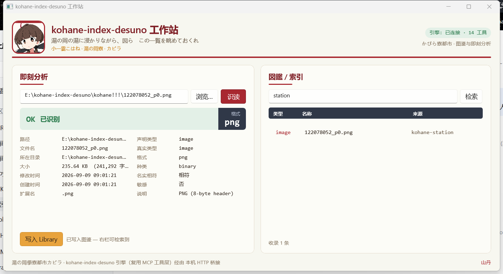

# kohane-index-desuno · 集成工作站 (KohaneStation)

一台 Windows 桌面工作站，把「**DIY 索引平台**（Fruity Wrapper 式封装层）+ **DiskInfo 式即刻文件分析**」
合并成一个 WinUI 3 应用，并融入 **小一孁琥珀子（こはね）** 的 persona 与美术风格
（Fluent / Mica 半透明 + 琥珀金·山丹·红光环·茶色）。

引擎侧复用 **kohane-index-desuno** 的纯 Node 核心（跨 harness，15 工具），壳与引擎经**本地 HTTP 桥接**沟通。

---

## 目录结构

```
workstation/
├─ KohaneStation.sln                  # VS 解决方案
├─ build.ps1                          # 一键构建（自动找 VS 的 MSBuild）
├─ tools/make-assets.ps1              # 从立绘重生成头像与图标（整套配色的来路也记在这里）
├─ src/KohaneStation/                 # WinUI 3 桌面壳
│  ├─ KohaneStation.csproj            # net8.0-windows / WinUI / WindowsAppSDK 1.5（自带运行时）
│  ├─ App.xaml(.cs)                   # 应用入口 + 湯の岡 纸主题（配色取自立绘）
│  ├─ MainWindow.xaml(.cs)            # 状态横幅 + 大号读数 + 两栏属性表 / 图鉴密表
│  ├─ Assets/                         # 头像与图标（make-assets.ps1 生成）
│  └─ app.manifest                    # PerMonitorV2 DPI
├─ engine-bridge/server.mjs           # 本地 HTTP 桥接（复用 MCP 工具层）
├─ docs/station.png                   # 当前界面留档
└─ data/                              # 工作站 Library（= DSH_HOME，自动创建）
```

---

## 编译（一条命令）

```powershell
cd E:\kohane-index-desuno\workstation
.\build.ps1                 # 等价于下面的 MSBuild 调用
```

或者直接：

```powershell
& "E:\VSPnEBs\Microsoft Visual Studio\2022\Community\MSBuild\Current\Bin\MSBuild.exe" `
    src\KohaneStation\KohaneStation.csproj /p:Configuration=Debug /p:Platform=x64
```

产物：`src\KohaneStation\bin\x64\Debug\net8.0-windows10.0.19041.0\win-x64\KohaneStation.exe`

### 为什么必须用 VS 的 MSBuild，而不是 `dotnet build`

WindowsAppSDK 的 XAML targets（`Microsoft.UI.Xaml.Markup.Compiler.interop.targets`）按**构建器运行时类型**
选路径：

| 构建器 | 工具集 | XAML 编译方式 |
|---|---|---|
| `dotnet build`（MSBuild runtime = Core） | `tools\net6.0\` | **强制** `UseXamlCompilerExecutable=true` → 调 `tools\net472\XamlCompiler.exe` |
| VS 的 `MSBuild.exe`（runtime = .NET Framework） | `tools\net472\` | 进程内任务（`Microsoft.UI.Xaml.Markup.Compiler.MSBuildInterop`） |

那个 net472 外壳是 .NET Framework 程序，它的 `XamlCompiler.exe.config` 里写着绑定重定向
（`System.Text.Json` → 6.0.0.1，另一代是 6.0.0.10；`System.Buffers` → 4.0.2.0），
而随包的 DLL 实际版本并不匹配（实测 6.0.0.0 / 4.0.3.0）。于是它在**程序集加载阶段**就失败，
并且**一个字节都不打印**（MSBuild 只看到 `MSB3073 … 已退出，代码为 1`），看起来像「静默失败」。
用 net472 的 MSBuild 时走的是进程内任务，依赖集由 MSBuild 自身提供，因此正常。

> 实测复现方式：把 `tools\net472\XamlCompiler.exe` 与 `tools\net6.0\*.dll` 复制到同一目录再运行，
> 它才会把真话吐出来（`Xaml Internal Error: 未能加载 System.Text.Json, Version=6.0.0.1 …`）。

### 顺带修掉的一个真 XAML 错误

`App.xaml` 原来写着 `RequestedTheme="Default"`，而 `ApplicationTheme` 只有 `Light` / `Dark`：

```
App.xaml(5,5): XamlCompiler error WMC0055:
Cannot assign text value 'Default' into property 'RequestedTheme' of type 'ApplicationTheme'
```

「跟随系统」的正确写法是**不写这个属性**。这条只有在 XAML 编译器真跑起来之后才会暴露，
也正是它一直在提示我们：之前的失败与项目无关，是工具链。

### 为什么工程里固化了「自带运行时」

`KohaneStation.csproj` 里有两行：

```xml
<WindowsAppSDKSelfContained>true</WindowsAppSDKSelfContained>
<RuntimeIdentifier>win-x64</RuntimeIdentifier>
```

本机**没有安装 Windows App Runtime**（注册表与「已安装程序」里都没有），
而非打包（`WindowsPackageType=None`）的 WinUI 3 应用需要它。自带运行时会把
`Microsoft.WindowsAppRuntime.dll` / XAML 引擎 / `*.pri` 资源一并复制到 exe 旁边，
于是**从 bin 目录直接双击就能跑**，不需要 MSIX 身份、也不需要管理员安装。

---

## 运行

先起桥接（纯 Node，复用 kohane-index-desuno 的 `TOOLS`）：

```powershell
cd E:\kohane-index-desuno\workstation\engine-bridge
node server.mjs
# -> http://127.0.0.1:8787
```

- `GET  /tools/list`             # -> { "tools": [ 15 个工具名 ] }
- `POST /tools/call  {name,args}` # -> 对应工具的 JSON 结果（如 library_sniff）

再启动壳：

```powershell
.\src\KohaneStation\bin\x64\Debug\net8.0-windows10.0.19041.0\win-x64\KohaneStation.exe
```

> Library 默认隔离在本机 `workstation\data`（DSH_HOME），不会污染 `~/.dsh`。

### 启动痕迹（排查用）

非打包的 WinUI 应用没有控制台可打印，启动失败会「一声不响」。因此每次里程碑都会追加一行到
**exe 同目录的 `startup.log`**：

```
23:32:08.088  MainWindow ctor: Title set
23:32:08.093  MainWindow ctor: Mica backdrop set
23:32:08.120  OnLaunched: MainWindow constructed
23:32:08.135  OnLaunched: Activate returned
```

设 `KOHANE_STATION_TRACE=0` 可关闭它。窗口本身可以用「按标题搜全桌面」的办法确认：
`class=WinUIDesktopWin32WindowClass`、`title=[kohane-index-desuno 工作站]`、物理尺寸 1440x785（125% 缩放下）。

### 无鼠标自检钩子（验证闭调用）

壳的左栏可以完全不用点鼠标就验一遍：

```powershell
$env:KOHANE_STATION_SMOKE        = "E:\some\file.png"   # 启动后自动识读这一条
$env:KOHANE_STATION_SMOKE_RECORD = "1"                  # 再写入 Library 并刷新右栏检索
```

于是「识读 → 收录 → 检索」全链会落进 `startup.log`：

```
analyze: done - detected=True type=image format=png
record: ok=True name=122078052_p0.png type=image
smoke: index panel says [收录 1 条] with 1 row(s)
```

首次跑通的样子（`docs/station.png`，窗口右上是「引擎: 已连接 · 15 工具」）：



---

## 桥接的库归属

**默认隔离**：桥会把 Library 指到 `workstation\data`，**不会**因为外层 shell 导出了 `DSH_HOME`
就悄悄写进机器级库（这一点曾经踩过——桥曾经继承了 `E:\dsh-home`）。

| 环境变量 | 作用 |
|---|---|
| （不设） | 用 `workstation\data`（隔离，推荐） |
| `KOHANE_BRIDGE_DSH_HOME` | 指定工作站库的落点 |
| `KOHANE_BRIDGE_SHARED=1` | 明确要求共用外层导出的 `DSH_HOME` |

---

## 视觉主题（立绘 → 配色，CrystalDiskInfo → 排版）

**配色不是想出来的，是从她的立绘里量出来的**（`tools/make-assets.ps1` 用的就是同一张画；
逐像素取色见下表）。这张画本身的构成——奶油纸、正红画框、茶发、藏青水手服——正好当成整套界面的规矩：

| 取处 | 色值 | 用途 |
|---|---|---|
| 画纸 | `#F8F8F0` | 窗口底色（留 4% 让 Mica 透一口气） |
| 画框 / 光环 | `#A82830` · 深 `#7E1D24` · 淡 `#F3E2E2` | 主行动色、卡片顶部细规、判定横幅 |
| 发色（茶） | `#685040` · 深 `#403028` | 正文与标题的墨、数据文字 `#2B2018` |
| 水手服（藏青） | `#303848` · 淡 `#E9EBF0` | 表头带、大号读数的底座 |
| 肤 / 腮红 | `#F8E8E0` · `#E09088` | 卡片底、悬停 |
| 判定色 | 绿 `#2E7D4F` · 琥珀 `#C08A1E` · 正红 `#A82830` | 「已识别 / 待注意 / 敏感」三档 |

**排版学 CrystalDiskInfo**（它好用的地方就是「一屏把身份与状态说完」）：

1. **判定横幅**：一整条彩色带，左端是判定词（`OK 已识别`），右端是**大号等宽读数**（格式名），
   一眼就知道这条东西「好不好、是什么」；
2. **两栏属性表**：像它有「型号 / 固件 / 接口 / 传输模式」那样，把
   路径·文件名·所在目录·大小·修改时间·创建时间·扩展名 放左栏，
   声明类型·真实类型·格式·种类·名实相符·敏感·说明 放右栏——十几个字段不用滚动就看全；
3. **等宽数据字体**（Consolas / Cascadia Mono）：数字与路径对齐，这是它的手感所在；
4. **藏青表头 + 密行**：右栏图鉴用「类型 / 名称 / 来源」三列密表，行高压到最低；
5. **卡片描边 + 顶部细规**：那道正红细规就是她画框的缩小版，也是全窗口的视觉节拍器。

她的脸则出现在两处：**窗口左上角的红框头像**（`Assets/kohane-avatar.png`）与**任务栏 / 标题栏图标**
（`Assets/kohane.ico`）——两件都由 `tools/make-assets.ps1` 从立绘裁出，重跑即可复原。

---

## 壳的功能

### ① 即刻分析（左栏，DiskInfo 式）
- 输入/拖放/浏览一个文件 → 调 `library_sniff` → 一屏给出**真实类型（magic byte）/ 格式 / 说明**；
- 一键「写入 Library」→ 调 `library_record` 存入图鉴。

### ② 图鉴 / 索引（右栏，Fruity Wrapper 式工作台）
- 关键词检索（name / description / source / tags）→ 调 `library_query`（带分页）；
- 展示收录条目、数量；配合左栏写入，形成「识读 → 收录 → 检索」闭环。

### ③ 琥珀子 persona
- Mica 半透明背景 + 琥珀金强调色（湯の岡 / 山丹/珊瑚百合）/ 山丹图腾 / 和歌式文案。
- 引擎状态栏：自动探测桥接，显示「已连接 · 15 工具」或「未连接」。

---

## 状态

- **引擎桥接**：端到端跑通（`/tools/list` 15 工具、`/tools/call` 正确返回），库默认隔离在 `workstation\data`。
- **WinUI 3 源码**：完整（壳 + 双面板 + persona 调色板 + manifest）。
- **编译**：命令行可复现（`build.ps1`），产出 `win-x64` 自带运行时版本。
- **运行**：已验证窗口出现（可见、标题正确），启动痕迹完整走完 `OnLaunched → Activate`。
- **B 线（引擎接进 UI）**：**已打通并验证**——无鼠标自检钩子跑完整链：
  识读 `library_sniff` → 结果面板显示 `image · png` / `PNG (8-byte header)` →
  「写入 Library」`library_record` 返回 OK（落在 `workstation\data`）→ 右栏 `library_query`
  检索到 1 条，状态栏「收录 1 条」。拖放与文件选择器走的是同一个 `AnalyzeAsync()`。
- **顺手修掉的两个真 bug**：
  ① 状态栏工具数永远显示 0——桥返回的是 `{tools:[...]}`，而壳对**根元素**取数组长度，已改为读 `tools` 字段；
  ② 桥会继承外层 `DSH_HOME` 从而写到机器级库，与「隔离」的承诺不符，已改为默认本地、需显式共用。
- **视觉主题**：**已落地**——配色全部取自立绘（纸白 / 正红 / 茶墨 / 藏青），
  排版照 CrystalDiskInfo（判定横幅 + 大号读数 + 两栏属性表 + 藏青表头密表），
  头像与图标由 `tools/make-assets.ps1` 从立绘生成。
- **待办**：右栏结果列表的富信息（命中高亮 / 双击打开 / 更多列）、拖放的视觉反馈、
  窗口尺寸与位置记忆、以及深色版的配色（现在这套是纸白主题，取自她的画纸；深色版需要重新取色）。

## 许可

MIT。See [LICENSE](../../kohane-index-desuno/LICENSE) in the engine package.
